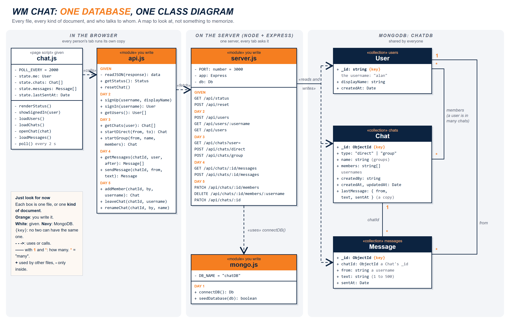

# WM Chat Starter: Direct Messages and Group Chats

West-MEC Coding Year 2. A full stack chat app: **Node + Express** on the server, **MongoDB Atlas** for the data, and a page that already looks finished. You write the parts that talk to the database.

By the end of the week you can:

- **Sign up and sign in** with a username (no two people can have the same one).
- **Direct message** one person, Messenger style.
- **Start a group**, then **add people**, **rename** it, or **leave** it, Discord style.
- Open the app in **two or three tabs**, signed in as different people, and watch the messages show up in each other's tabs.

Everything lives in one database, `chatDB`, with three collections: `users`, `chats`, and `messages`.

## Setup

1. Open the terminal: **PowerShell**, **Git Bash**, or **Command Prompt** (any one works).
2. Move into your code folder on the Desktop (use your folder's real name):

   ```
   cd Desktop
   cd code
   ```

   Desktop not found? It may be inside OneDrive: `cd OneDrive`, then `cd Desktop`.

3. Clone the chat, then move into it:

   ```
   git clone https://github.com/Xerrath/wm-chat-starter.git
   cd wm-chat-starter
   ```

4. Install the packages (Express and the MongoDB driver):

   ```
   npm install
   ```

5. Make your `.env` file: copy `.env.example` and name the copy `.env`. Paste your **Atlas connection string** after `MONGODB_URI=` (no spaces, no quotes, your real password in place of `<db_password>`).
6. Start the chat:

   ```
   npm start
   ```

7. Open **http://localhost:3000** in Chrome. Gray line `Chat not connected: connectDB() is not built yet (Day 1)`? That's right: you build it.

Stop the server with **Ctrl+C**. After you change a server file (`mongo.js`, `server.js`), stop it and `npm start` again. After you change `public/api.js`, just refresh the page.

## The files

| File | What it is | Do you change it? |
| --- | --- | --- |
| `mongo.js` | Connects to MongoDB and sets up `chatDB` the first time. | **Yes (Day 1)** |
| `server.js` | The Express server and every `/api` route. | **Yes (Days 2 to 5)** |
| `public/api.js` | Every `fetch` the page makes to the server. | **Yes (Days 2 to 5)** |
| `public/chat.js` | Draws the page and decides WHEN to ask the server (every 2 seconds). | No (read it!) |
| `public/index.html`, `global.css`, `images/` | The chat page. | No |
| `setup/` | Status and reset routes, the practice server, the MongoDB download. | No |
| `.env` | Your connection string. **Never on GitHub.** | Yes (Day 1) |



## Test it with more than one person

You are the only one on your database, so **you play every person**. Each browser **tab** remembers its own sign-in:

1. Tab 1: sign up as yourself.
2. Tab 2 (Ctrl+T, same address): sign up as a second person.
3. Message each other. The other tab gets it within 2 seconds.

## See your data

- **Atlas:** Data Explorer (Browse Collections) > `chatDB` > `users`, `chats`, `messages`.
- **Any GET route** in the browser, like **http://localhost:3000/api/users**.
- **Start over:** the **Reset chat** button empties `chatDB` and puts WM Bot and the West-MEC Lounge back. Every account is gone, so sign up again.

## Stuck?

- **EADDRINUSE**: the chat is already running in another terminal. Ctrl+C there.
- **I changed server.js but nothing changed**: stop the server (Ctrl+C) and `npm start` again.
- **`querySrv` / timeout errors**: the network may block Atlas, or your IP isn't on the Atlas IP Access List. Tell your teacher.
- **`bad auth`**: the password in your string is wrong. It's the **database user** password, not your Atlas login.
- **No Atlas today?** Leave `MONGODB_URI=` empty to use a practice MongoDB on this computer (`npm run check-mongodb`, and only if it says NO, `npm run get-mongodb`). Ask your teacher first: it's a big download.

Needs Node.js 20.19 or newer (`node -v` to check).
